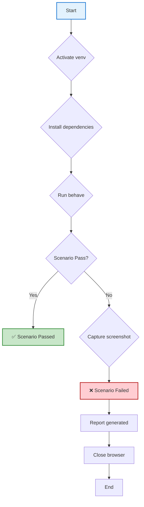

# 🛒 E-commerce BDD Automation Framework

[](https://pypi.org/project/behave/)
[](https://www.selenium.dev/)
[](https://www.python.org/)
[](https://opensource.org/licenses/MIT)

---

## 📖 Overview

A Python **Behavior-Driven Development (BDD)** automation framework for the **Sauce Demo** e-commerce application. This project demonstrates hands-on experience with modern test automation technologies, including:

- **Behave** – BDD test runner using Gherkin syntax
- **Selenium WebDriver** – Browser automation across Chrome
- **Page Object Model (POM)** – Maintainable and reusable test design
- **Gherkin** – Human-readable `.feature` files with Given/When/Then

**Application Under Test:** <https://www.saucedemo.com>  
**Demo Credentials:** `standard_user` / `secret_sauce`

---

## 🚀 Technologies Used

| Category | Technology | Purpose |
|----------|------------|---------|
| **BDD** | **Behave 1.3.3** | Test runner executed via Gherkin `.feature` files |
| **Browser Automation** | **Selenium WebDriver 4.51.0** | Interacts with the UI through Chrome |
| **Browser Driver** | **webdriver-manager 4.1.2** | Auto-manages ChromeDriver version |
| **Language** | **Python 3.11+** | Core scripting language |
| **Design Pattern** | **Page Object Model** | Encapsulates page elements & interactions |
| **Reporting** | **Behave built-in** | Console output; screenshots on failure |

---

## 🟦 BDD & Gherkin

### What is BDD?
**Behavior-Driven Development (BDD)** is a software development approach that encourages collaboration between developers, QA, and non-technical stakeholders. BDD uses plain-language descriptions of software behaviors, written in **Gherkin**, which can be executed as automated tests.

### Why Gherkin is useful?
Gherkin is a language that allows describing test scenarios in a human-readable format using **Given/When/Then** syntax. It serves as both **documentation** and **automated test code**, bridging the gap between business requirements and technical implementation.

### Behave vs Cucumber Terminology

| Behave (Python) | Cucumber (Java) | Description |
|---|---|---|
| **Feature File** | Feature File | Contains Gherkin scenarios |
| **Scenario** | Scenario | A list of steps with Given/When/Then |
| **Step Definition** | Step Definition | Maps Gherkin steps to Python code |
| **Context** | Scenario Context | Passes data between steps (`context.driver`) |
| **Tag** | Tag | Filters which scenarios to run |
| **`behave`** | `cucumber-jvm` | The BDD test runner |

---

## 📁 Project Structure

```text
ecommerce-bdd-automation/
├── behave.ini              # Config: steps_dirs=steps
├── requirements.txt        # Pinned dependencies
├── .gitignore              # .venv, __pycache__, reports/*.png
├── README.md               # This file 📖
├── reports/                # Generated screenshots & reports
├── features/
│   ├── login.feature       # 2 Gherkin scenarios (valid/invalid login)
│   └── shopping_cart.feature  # 2 Gherkin scenarios (cart badge & view)
│   └── environment.py      # before/after scenario hooks, screenshot on failure
├── pages/
│   ├── login_page.py       # LoginPage Object
│   ├── inventory_page.py   # InventoryPage Object
│   └── cart_page.py        # CartPage Object
└── steps/
    ├── login_steps.py      # step definitions for login
    └── shopping_steps.py   # step definitions for shopping cart
```

---

## ▶️ How to Run (Windows PowerShell)

### 1. Clone & Setup

```powershell
# Clone the repository
git clone https://github.com/CODY-FSAIML/E-commerce-BBD-automation.git

# Navigate into project
cd E-commerce-BBD-automation

# Create and activate virtual environment
python -m venv .venv
.\.venv\Scripts\Activate.ps1

# Install dependencies
pip install -r requirements.txt
```

### 2. Run All Scenarios

```powershell
behave
```

### 3. Run Specific Feature File

```powershell
behave features\login.feature
behave features\shopping_cart.feature
```

### 4. Run with Tags

```powershell
behave --tag login
behave --tag cart
```

### 5. Generate JUnit XML Report

```powershell
behave --junit-output=reports\results.xml
```

### 6. View Screenshots on Failure

When a scenario fails, a screenshot is automatically saved under:

```
reports/failure_<scenario_name>_<YYYYMMDD_HHMMSS>.png
```

---

## 🧪 Implemented Scenarios

| Scenario | Feature File | Status |
|---|---|---|
| **Successful login** with valid credentials | `login.feature` | ✅ PASSED |
| **Unsuccessful login** with invalid credentials | `login.feature` | ✅ PASSED |
| **Add product to cart** & verify cart badge | `shopping_cart.feature` | ✅ PASSED |
| **Open cart** & verify selected product appears | `shopping_cart.feature` | ✅ PASSED |

**Results:** 3 scenarios passed, 0 failed, 15 steps passed

---

## 🛠️ Workflow Diagram



---

## 📸 Screenshot on Failure

When a scenario fails, the `after_scenario` hook in `features/environment.py` automatically:

1. Saves a PNG screenshot under `reports/`
2. Naming format: `failure_<scenario_name>_<timestamp>.png`
3. Prints the path to the console

**Example:** `reports/failure_successful_login_20261013_1843.png`

---

## 📦 Requirements

```text
behave==1.3.3
selenium==4.51.0
webdriver-manager==4.1.2
```

**Prerequisites:**
- Windows OS with [Google Chrome](https://www.google.com/chrome/) installed
- Internet access to https://www.saucedemo.com
- Python 3.11+ from [python.org](https://www.python.org/)

---

## 🛡️ License

This project is licensed under the **MIT License** - see the [LICENSE](LICENSE) file for details.

---

*Built with ❤️ for demonstration of Python BDD, Selenium WebDriver, and Page Object Model skills.*